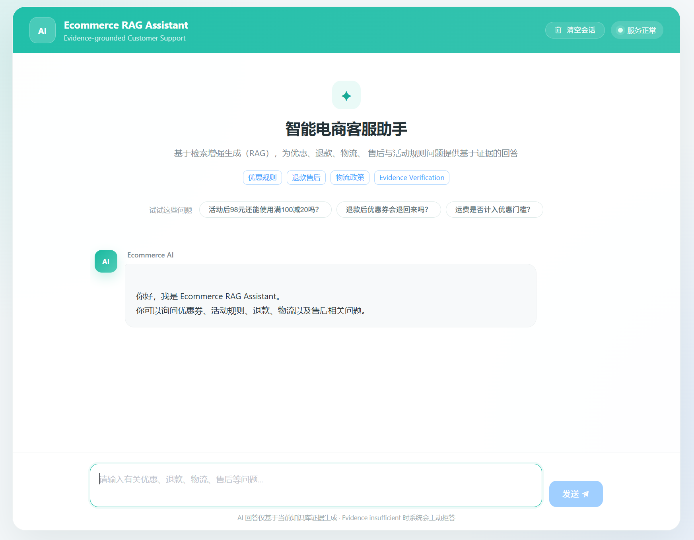
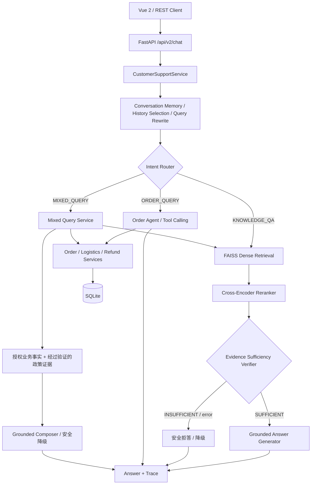

# Ecommerce RAG Assistant

**面向中文电商场景的多轮智能客服系统｜Agentic RAG · Evidence Gate · Business Tools · FastAPI · Docker · GitHub Actions**

一个以**“可信回答优先于强行回答”**为设计原则的工程化 RAG 项目：商品政策问题通过检索、重排与证据充分性校验生成答案；订单、物流和退款信息通过受约束的业务工具读取 SQLite；复合问题在两类已验证事实的基础上回答。项目还实现了多轮上下文、失败安全降级、结构化日志、离线回归测试和本地 Docker 演示部署。

> **项目定位**：求职展示 / 本地技术演示项目，并非可以直接公开部署的生产客服服务。当前 HTTP 请求中的 `user_id` 由演示客户端提供，**尚无真实身份认证**；业务工具会按该 `user_id` 做数据隔离，但不能将其等同于生产级鉴权。

[功能演示](#功能演示) · [核心设计](#核心设计与架构) · [评估结果](#评估结果与口径说明) · [Docker 部署](#docker-deploy) · [Python 本地运行](#python-local) · [API 示例](#api-使用示例) · [测试与-ci](#验证测试与持续集成)

## 功能演示



前端采用 **Vue 2 + Element UI**，由 FastAPI 直接托管；无需单独启动 Node.js 前端开发服务。页面使用 `/api/v2/chat`，会保留服务端返回的 `conversation_id`，因此**当前前端支持多轮会话**，不再是旧版 README 描述的“只有单轮请求”。浏览器加载 Vue、Element UI、Axios 时依赖外部 CDN，离线浏览器可能无法完整渲染。

支持的典型问题：

- **政策知识问答**：「七天无理由退货必须保留商品原包装吗？」
- **订单与物流**：「帮我查一下 `ORD202610002` 现在到哪里了？」
- **多轮追问**：「这笔订单呢？」「它什么时候到？」
- **退款进度**：「帮我查询这个订单的退款状态。」
- **复合问题**：「我的订单在运输中，如果想退货应该符合什么条件？」

演示订单示例：`user_id=U001`，订单 `ORD202610002`。数据来自项目的本地演示种子数据，不代表真实电商平台订单。

## 核心设计与架构



### 项目亮点

| 能力 | 设计与工程价值 |
| --- | --- |
| **Evidence Gate** | 在 Retrieval / Rerank 与生成之间设置独立的 Answerability Verifier；证据不足时 `INSUFFICIENT` + Abstain，避免无依据编造政策。 |
| **两阶段检索** | `BAAI/bge-small-zh-v1.5` Embedding + FAISS 召回，`BAAI/bge-reranker-v2-m3` Cross-Encoder 重排；默认候选 `10` 条、最终证据 `3` 条。 |
| **Agent + Business Tools** | Intent Router 在知识问答、订单查询和复合查询之间路由；订单、物流、退款经业务服务访问 SQLite，不让模型臆测实时业务状态。 |
| **多轮对话与上下文解析** | 维护 `conversation_id`，结合会话记忆、History Selection、Query Rewrite、Context Resolver 支持省略指代和上下文追问。 |
| **权限边界与失败安全** | 工具查询使用服务层传入的 `user_id`，不信任模型自造的用户身份；越权记录按 `NOT_FOUND` 处理，Verifier/组件异常有安全降级路径。该能力**不代替 HTTP 层身份认证**。 |
| **可观测性与分层评估** | Request ID、结构化 Trace、Router / Retrieval / Verifier / Tool / Composer 耗时；包含 Retriever、Verifier、Generation、E2E 等评估工具。 |
| **工程交付** | Python 3.11、FastAPI、SQLite、单容器 Docker Compose、本地数据及模型缓存持久化、GitHub Actions 轻量离线 CI。 |

### 技术栈

- **后端**：Python 3.11、FastAPI、Pydantic、Uvicorn。
- **RAG**：Sentence Transformers、FAISS CPU、Transformers、PyTorch、BGE Embedding / Cross-Encoder。
- **LLM**：阿里云 DashScope（OpenAI-compatible 接口），用于路由、改写、证据校验、生成与 Tool Calling。
- **数据**：Markdown 政策知识库、FAISS 索引、SQLite（订单、物流、退款、会话）。
- **前端**：Vue 2、Element UI、Axios（CDN 加载）。
- **交付**：Docker Compose、GitHub Actions、`unittest`、性能 Trace 脚本。

**模型配置说明**：Embedding 固定默认 `BAAI/bge-small-zh-v1.5`；Reranker 默认 `BAAI/bge-reranker-v2-m3`。当前 `src/config/settings.py` 中 LLM 的代码默认值为：Verifier `qwen3.6-plus`，Generator / Router / Query Rewriter `qwen3.6-flash`；**实际生效模型以本地 `.env` 覆盖后的配置为准**。仓库 `.env.example` 中的 Verifier 模型字符串与当前代码默认值不一致，复制模板后请检查并设置为**自己现有账号确实可调用**的模型，不需要为了运行此项目另行购买其他模型额度。

## 评估结果与口径说明

### 历史 V1：60 条 Full Pipeline E2E 评估

仓库已归档的 `evaluation/results/e2e/e2e_pipeline_results_v1.json` 和 `evaluation/reports/e2e_pipeline_report_v1.md` 记录了一轮 **60 条 E2E** 评估。以下指标来自**这轮历史记录**，不是本次 README 更新时重新执行的测试：

| 指标 | 归档结果 | 分母 / 说明 |
| --- | ---: | --- |
| 总用例数 | **60** | `generation_questions_v1.json` |
| 已完成评估 | **60 / 60** | 该归档记录 `errors=0` |
| Verifier Accuracy | **98.33%** | TP 44、TN 15、FP 0、FN 1 |
| Verifier Precision | **100.00%** | TP / (TP + FP) |
| Verifier Recall | **97.78%** | TP / (TP + FN) |
| Verifier F1 | **98.88%** | 历史报告中的四舍五入值 |
| Retrieval Hit Rate | **100.00%** | **46 / 46** 个参与该项检索诊断的样本，而非全部 60 条 |
| Routing Accuracy | **98.33%** | **59 / 60**；有 1 条因 Verifier 假阴性而偏离预期路由 |
| Pipeline Consistency | **100.00%** | **60 / 60**；编排忠实执行了 Verifier 的判定，不等于所有答案都正确 |

已知边界案例 `b2_q50`：标注为证据充分，但 Verifier 判为 `INSUFFICIENT`，系统选择拒答。这属于**Verifier False Negative**，不是“所有问题都成功作答”。

**重要：不要将不同轮次混写为“60/60 最新回归通过”。** P1 后续另一次 60 条回归在交接记录中为 **57 条有效、3 条 `PIPELINE_ERROR`**，并曾进行定向诊断和评估兼容性修复；截至交接时**没有重新执行完整 60 条确认复测**。因此，上表只能作为**有归档结果支撑的历史 V1 基线**，不能代表当前提交的最新准确率或“生产稳定性 100%”。

复现与查看：

- 数据集：[`evaluation/datasets/generation_questions_v1.json`](evaluation/datasets/generation_questions_v1.json)
- 历史 JSON：[`evaluation/results/e2e/e2e_pipeline_results_v1.json`](evaluation/results/e2e/e2e_pipeline_results_v1.json)
- 报告：[`evaluation/reports/e2e_pipeline_report_v1.md`](evaluation/reports/e2e_pipeline_report_v1.md)
- 评估脚本：[`evaluation/e2e/evaluate_pipeline.py`](evaluation/e2e/evaluate_pipeline.py)

> 完整 E2E 需要加载本地模型并使用真实 LLM API，**可能产生费用**；它不属于默认 CI 检查。

### P2-B：小样本性能定位（非正式 benchmark）

2026-10-21 使用本地 Docker 和 HTTP + Trace 记录了两条**探索性单请求**：

| 场景 | HTTP 客户端总耗时 | 服务端 Verifier | 服务端 Composer |
| --- | ---: | ---: | ---: |
| `ORDER_QUERY` / `ORDER_AGENT` | **7.89 s** | 0 s | 1.45 s |
| `KNOWLEDGE_QA` / `RAG` | **64.38 s** | **38.27 s** | **18.02 s** |

Knowledge QA 的 Verifier 在这一次样本中约占服务端总耗时 **59.45%**。P2-B 据此增加了**可选的 Verifier 思考模式参数**和 **7 项离线安全回归测试**；未更换模型、未绕过 Evidence Gate。**当前没有完成优化前后的真实 A/B 测试，所以不宣称加速百分比、P50 或 P95。**

- 探索性数据与限制：[`docs/p2b_pilot_results.md`](docs/p2b_pilot_results.md)
- 优化候选与回滚方案：[`docs/p2b_verifier_thinking_experiment.md`](docs/p2b_verifier_thinking_experiment.md)

## 快速运行

以下两种方式均在**项目根目录**执行命令。建议 Python 3.11；首次运行需要下载 Hugging Face 模型，磁盘和内存开销较大。索引文件与 SQLite 数据库为本地生成数据，**默认不随 Git 仓库提交**。

<a id="docker-deploy"></a>

### 方式一：Docker Compose 部署

适合快速复现本地演示。已在 Windows 11 + Docker Desktop + Compose 环境做过镜像构建、健康检查、前端、订单查询及卷持久化验收；不代表公网生产部署已验证。

**前置条件**：Docker Desktop（Linux containers）、Docker Compose v2、足够的磁盘空间、可用的 DashScope API Key。以下 PowerShell 命令使用 Windows 主机；Mac / Linux 请将 `Copy-Item` 换为 `cp`。

**1. 克隆仓库并准备配置**

```powershell
git clone https://github.com/1159658813/ecommerce-rag-assistant.git
cd ecommerce-rag-assistant
Copy-Item .env.example .env
```

编辑 `.env`，至少设置真实密钥：

```dotenv
DASHSCOPE_API_KEY=在本机填写真实密钥
```

同时检查 `.env` 中的 `ANSWERABILITY_VERIFIER_MODEL` 等模型配置是否与你**已有的可用额度**一致；不要提交 `.env`。如不想覆盖 `settings.py` 中的 Verifier 模型默认值，可以删除模板复制来的 `ANSWERABILITY_VERIFIER_MODEL` 行。

**2. 构建镜像**

```powershell
docker compose config --quiet
docker compose build
```

若所在网络使用特定镜像站，可覆盖构建源（**可选**，不是所有机器都需要）：

```powershell
docker compose build --build-arg DEBIAN_MIRROR=https://mirrors.ustc.edu.cn --build-arg PIP_INDEX_URL=https://mirrors.ustc.edu.cn/pypi/simple
```

镜像包含 PyTorch、FAISS 和检索模型相关依赖，首次构建可能较慢、占用较大空间。

**3. 首次生成知识库索引（已有索引可跳过）**

```powershell
docker compose run --rm rag-app python scripts/build_index.py
```

该命令从 `data/raw/` 读取 Markdown 政策并在挂载的 `data/index/` 生成 `knowledge.faiss`、`chunks.json`；可能下载 Embedding 模型和 Qwen tokenizer。网络受限时需先设置可用网络环境；不要照搬其他人的代理端口。

**4. 本机启动与验收**

```powershell
python scripts/docker_preflight.py   # 可选：主机已装 Python 3.11 时运行
docker compose up -d
docker compose ps
Invoke-RestMethod http://127.0.0.1:8000/health
```

访问：

- 前端：<http://127.0.0.1:8000/>
- API 文档：<http://127.0.0.1:8000/docs>
- 健康检查：<http://127.0.0.1:8000/health>

如需查看启动日志：

```powershell
docker compose logs --tail=120 rag-app
```

`GET /health` 返回 `{"status":"ok"}` 只代表应用启动和路由可用，**不等于**检索质量、模型 API 或业务权限已完成验证。

**数据持久化与停止**：`./data` Bind Mount 到 `/app/data`；Hugging Face 模型缓存在 Compose 命名卷 `hf-cache` 中。容器启动时会执行幂等的演示 SQLite 初始化。停止服务：

```powershell
docker compose down
```

**不要使用 `docker compose down -v`**，否则可能删除缓存卷。应用端口仅绑定 `127.0.0.1:8000`，不要改成公网暴露。Docker 代理配置与更多部署细节参见 [`docs/docker_deployment.md`](docs/docker_deployment.md)。

<a id="python-local"></a>

### 方式二：不使用 Docker，在本地运行

适合 Python 开发、调试及 PyCharm / Conda 环境。以下为 **Windows PowerShell + Conda** 示例；使用 `venv` 也可以。

**1. 克隆仓库并创建环境**

```powershell
git clone https://github.com/1159658813/ecommerce-rag-assistant.git
cd ecommerce-rag-assistant
conda create -n rag-shop python=3.11
conda activate rag-shop
```

**2. 安装 Python 依赖**

```powershell
python -m pip install -r requirements.txt
```

依赖包含 Torch、Transformers、Sentence Transformers 与 FAISS，首次安装及模型下载需要网络、内存和较大磁盘空间。

**3. 配置 `.env`**

```powershell
Copy-Item .env.example .env
```

编辑 `.env` 并设置 `DASHSCOPE_API_KEY`；确认模型名称与现有账号额度相符。`.env` 已被 Git 忽略，不要上传或打印真实密钥。

**4. 初始化 SQLite 演示数据并构建 FAISS 索引**

```powershell
python -m src.orders.init_db
python scripts/build_index.py
```

- `init_db` 创建订单、物流、退款、会话表，并幂等写入演示种子数据。
- `build_index.py` 在 `data/index/` 生成 `knowledge.faiss` 和 `chunks.json`；若已有有效索引且知识库未变更，可跳过此命令。
- 首次模型下载依赖可访问 Hugging Face；不需要每次启动都重建索引。

**5. 检查环境并启动**

```powershell
python scripts/verify_project.py --mode quick
python -m uvicorn src.api.app:app --host 127.0.0.1 --port 8000
```

服务加载完成后打开 <http://127.0.0.1:8000/> 或 <http://127.0.0.1:8000/docs>。推荐使用上述 `src.api.app:app` 入口，不要把根目录 `app.py` 与正式多轮服务入口混淆。

### 常见部署问题

| 现象 | 优先检查 |
| --- | --- |
| `DASHSCOPE_API_KEY` 缺失 | 项目根目录 `.env`，不能只修改 `.env.example`。 |
| `knowledge.faiss` / `chunks.json` 不存在 | 先执行 `python scripts/build_index.py` 或 Docker 内构建命令。 |
| 首次启动慢 | Embedding、Reranker 加载 / 模型下载；后续可复用缓存。 |
| Docker 构建或模型下载失败 | 区分 Docker Hub、APT、PyPI、Hugging Face 的网络路径；不要直接硬编码代理地址。 |
| 前端页面缺少组件 | 浏览器能否访问 `unpkg.com` 上的 Vue、Element UI、Axios 资源。 |
| 订单查询未命中 | 确认初始化数据库，并使用匹配演示数据的 `user_id` 和订单号。 |
| Knowledge 问题被拒答 | 先检查 `verdict` 与 Evidence；证据不足时拒答是预期行为，不能为了提高回答率绕过校验。 |

## API 使用示例

正式多轮客服使用 `POST /api/v2/chat`；旧版独立知识问答可使用 `POST /api/v1/query`。

### `GET /health`

```http
GET /health
```

```json
{"status": "ok"}
```

### `POST /api/v2/chat`（推荐）

PowerShell 示例：

```powershell
$body = @{
    user_id = 'U001'
    question = '帮我查一下 ORD202610002 现在到哪里了？'
} | ConvertTo-Json -Compress

Invoke-RestMethod -Uri 'http://127.0.0.1:8000/api/v2/chat' `
    -Method Post `
    -ContentType 'application/json; charset=utf-8' `
    -Body ([System.Text.Encoding]::UTF8.GetBytes($body))
```

返回内容含 `conversation_id`、`user_id`、`question`、`resolved_question`、`memory_used`、`intent`、`handler`、`answer`、`result`。第二轮请求携带上一轮响应里的 `conversation_id`：

```json
{
  "user_id": "U001",
  "conversation_id": "上一轮返回的会话ID",
  "question": "它现在到哪里了？"
}
```

`user_id` 在此仅为演示身份参数，真实部署必须由鉴权层签发并绑定到用户会话，而不是信任客户端直接提交的任意值。

### `POST /api/v1/query`（知识问答）

```json
{
  "question": "七天无理由退货必须保留商品原包装吗？"
}
```

典型返回字段：`question`、`answer`、`abstained`、`abstain_reason`、`verdict`、`evidences`。Evidence 包含 `rank`、`source`、`section`、`content`、`reranker_score`。当证据不足时，期望 `verdict=INSUFFICIENT` 并安全拒答。API 中间件提供 `X-Request-ID` 响应头，便于定位日志。

## 验证、测试与持续集成

**本地快速验证（无须在线大模型测试）**：

```powershell
python -m compileall -q src scripts tests
python -m unittest tests.test_p2b_verifier_toggle -v
python scripts/p2_trace_summary.py --self-test
python scripts/p2_perf_trace_pilot.py --self-test
```

当前仓库包含 **7 项 Verifier / Evidence Gate 离线回归测试**；检查可选思考参数的默认行为和解析/拒答边界。这些测试通过 mock 隔离外部 LLM，不代表完整端到端质量验收。

**项目检查**：

```powershell
python scripts/verify_project.py --mode quick
# 以下模式会使用真实服务链路，可能加载模型并产生 API 调用费用：
# python scripts/verify_project.py --mode api
# python scripts/verify_project.py --mode full
```

**GitHub Actions**：`.github/workflows/ci.yml` 配置 Python 3.11 轻量检查，在 Pull Request 和 `main` Push 时执行编译、7 项单测和两项脚本 self-test。CI 只安装小体积测试依赖，**不下载模型、不调用 DashScope、无需配置 API Key**；**不包含**完整 60 条付费 E2E。实际运行状态以仓库 Actions / PR Checks 为准。

对于正式 60 条 E2E 评估，先确认 API 费用、数据集与本地模型环境，再单独执行：

```powershell
# 会运行真实 RAG Pipeline；默认开发或 CI 流程不执行
python evaluation/e2e/evaluate_pipeline.py
```

## 仓库结构

```text
ecommerce-rag-assistant/
├── .github/workflows/ci.yml        # GitHub Actions 离线 CI
├── Dockerfile / compose.yaml       # 单容器本地演示
├── frontend/                       # Vue 2 + Element UI Web 前端
├── data/
│   ├── raw/                        # Markdown 电商政策
│   ├── index/                      # 本地生成：FAISS + chunks（不跟踪）
│   └── database/                   # 本地生成：SQLite（不跟踪）
├── src/
│   ├── api/                        # FastAPI、API Schema
│   ├── customer_support/           # 多轮请求编排、Mixed Query
│   ├── memory/                     # 会话、History、Rewrite、Context
│   ├── routing/                    # Intent Router
│   ├── agents/ / orders/           # Tool Calling 与订单业务
│   ├── ingestion/ / retrieval/     # Markdown 切分、Embedding、FAISS、Rerank
│   ├── verification/ / generation/ # Evidence Gate 与 Grounded Generation
│   ├── pipeline/ / reliability/    # RAG 流程及故障安全策略
│   └── observability/ / config/    # Trace 与环境配置
├── evaluation/                     # 数据集、分层评估与历史结果
├── experiments/                    # 功能与集成 smoke tests
├── tests/                          # 离线单测
├── scripts/                        # 索引、预检、性能采样及工具
├── docs/                           # 部署、实验说明、演示截图
├── requirements.txt
└── README.md
```

## 里程碑与边界

- **P1 / `v2.1.0`**：核心多轮能力、退款工具、上下文选择与重写、评估与可靠性基线冻结。
- **P2-A**：Docker Compose 本地部署完成，PR #1 已合并。
- **P2-B**：性能探索性采样、可选 Verifier 思考模式与离线安全测试，PR #2 已合并；**不声称已验证加速**。
- **P2-C**：轻量 GitHub Actions 离线 CI（PR #3），在 PR / `main` 更新时执行最小化自动化检查；实际 CI 状态以 GitHub Checks 为准。

### 安全与工程限制

1. 演示服务**未实现真实登录 / 鉴权**；`user_id` 仅用于测试业务隔离，不能直接作为公网真实身份。
2. `.env`、Token、订单真实数据、原始含私密信息的日志不得提交。仓库提供 `.env.example` 作为配置模板。
3. SQLite、单容器、单工作进程是为了低门槛演示，**不声称高并发生产能力**。
4. 模型服务、外部 CDN 和首次 Hugging Face 下载可能依赖网络；性能受外部 LLM API 影响明显。
5. 历史 E2E 指标和探索性耗时都明确保留样本口径；**不把离线 CI 绿灯解释成整个 RAG 系统 100% 正确**。

---

**Project goal:** Build a small but traceable, testable and reproducible customer-support RAG system with evidence-first decisions, scoped business tools, and explicit failure boundaries.
